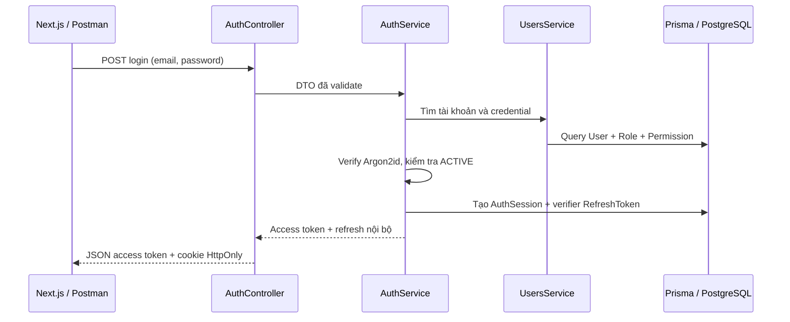
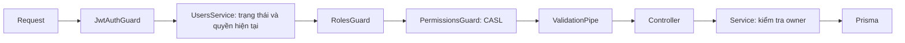

# Auth LumiKids: thiết kế, triển khai và kiểm thử

## Trạng thái và các quyết định nghiệp vụ

Module đã được viết dưới `apps/api/src/modules/auth` và `modules/users`. Giữ NestJS 12, Prisma 7.10.1 ESM và PrismaPg hiện có. Không có SRS độc lập trong repository dù AGENTS nhắc đến `srs_tuan06.md`; không coi những quyền lớp học/trẻ trong ví dụ là nghiệp vụ đã triển khai.

Tài khoản được cấp nội bộ; seed development đã được yêu cầu riêng và được mô tả trong [SEED.md](./SEED.md). Phạm vi Auth:

- Chỉ có `ROLE_ADMIN`, `ROLE_TEACHER`, `ROLE_GUARDIAN`; không có vai trò hay permission dành cho trẻ đăng nhập.
- Không có đăng ký công khai hoặc admin được tạo tự động khi khởi động. Seed chỉ chạy khi gọi lệnh development có chủ đích. Xác minh email, mời giáo viên và cấp tài khoản phụ huynh chưa được định nghĩa.
- Permission gồm `READ_OWN_ACCOUNT`, `MANAGE_USERS` và `GENERATE_GAME_CONTENT`. Quyền sinh trò chơi đã được migrate và seed cho Admin/Teacher theo SEED.md. Không tự gán permission theo tên role; quyền có hiệu lực phải tồn tại trong `RolePermission`.
- Chưa tạo Teacher, Guardian, Child, Classroom hay bảng nghiệp vụ khác. `User.userId`, `fullName`, `email`, `phone`, `address` giữ đúng tên trong Domain Model.
- Tài khoản mặc định `DISABLED`; người cấp tài khoản phải chủ động đặt `ACTIVE`. Đây là trạng thái kỹ thuật cho Auth, chưa phải quy trình kích hoạt email.

## Giai đoạn 1–2: dữ liệu và migration

Schema gồm 7 bảng:

| Bảng | Trách nhiệm |
|---|---|
| User | Định danh UUID, thông tin tài khoản, passwordHash, trạng thái |
| Role / Permission | Danh mục mã hợp lệ, ràng buộc unique và enum |
| UserRole / RolePermission | Quan hệ nhiều-nhiều, khóa chính ghép chống trùng |
| AuthSession | Một lần đăng nhập/thiết bị, thời hạn tuyệt đối và trạng thái thu hồi |
| RefreshToken | Selector UUID, verifier SHA-256, thời hạn và usedAt; giữ token đã dùng để phát hiện replay |

Email được trim/lowercase khi đăng nhập và có unique index. SQL migration bổ sung CHECK để các lần insert thủ công cũng phải lưu email lowercase, không có khoảng trắng đầu/cuối. Không tự chuẩn hóa mật khẩu.

Migration: `apps/api/prisma/migrations/20261109000100_init_auth/migration.sql`. Được sinh **offline** bằng:

```sh
pnpm --filter api exec prisma migrate diff --from-empty --to-schema prisma/schema.prisma --script --output prisma/migrations/20261109000100_init_auth/migration.sql
```

Đã review SQL: chỉ tạo schema/enum/bảng/index/FK/CHECK, không INSERT, DROP hay DELETE; bọc trong BEGIN/COMMIT. Cách tạo offline tránh dùng shadow database hoặc vô tình chạy migration trước khi được phép. `migration_lock.toml` ghi provider PostgreSQL.

**Đã áp dụng migration `20261109000100_init_auth` và `20261109000200_add_game_generation_permission` vào database development ngày 09/11/2026 sau khi người dùng xác nhận. Các lần áp dụng migration tiếp theo vẫn cần xác nhận trước:**

```sh
pnpm --filter api prisma:migrate:deploy
```

Lệnh áp dụng migration này lên DATABASE_URL đang cấu hình và tạo lịch sử `_prisma_migrations`. Nếu database đã có bảng trùng tên hay lịch sử khác, phải kiểm tra trước; không tự baseline/reset/xóa dữ liệu. Không chạy db push, migrate reset hay seed.

## Giai đoạn 3: Users và DI

`UsersModule` import PrismaModule và export UsersService. Nest tạo một PrismaService dùng chung qua DI; không tạo client riêng trong Auth.

UsersService có ba trách nhiệm: đọc credential phục vụ login; lấy principal an toàn cho request đã xác thực; kiểm tra quyền trên tài khoản cụ thể. Query credential chỉ dùng nội bộ. `toPrincipal()` chủ động chọn trường trả ra, không đưa passwordHash vào response dù query login có hash.

Auth không tự query bảng User; chỉ dùng UsersService. AuthSessionsRepository sở hữu các thao tác trên AuthSession/RefreshToken. Không tạo GenericRepository hoặc interface UseCase không cần thiết.

## Giai đoạn 4: authentication



PasswordService dùng Argon2id: memory 19456 KiB, time cost 2, parallelism 1, salt do thư viện tạo. Hash cùng mật khẩu hai lần cho kết quả khác nhau. Tài khoản không tồn tại vẫn verify với dummy hash để giảm khác biệt thời gian. Email sai, password sai và tài khoản disabled đều nhận cùng lỗi login 401.

Access JWT dùng HS256 với secret môi trường tối thiểu 32 ký tự, hạn mặc định 900 giây. Verify chữ ký, thuật toán, issuer, audience, exp, iat, jti UUID, sub UUID và `tokenUse=access`. Không đưa password hay refresh token vào JWT. Refresh token opaque không thể dùng làm access token.

Refresh là `UUID-selector.random-256-bit-secret`. Database chỉ lưu SHA-256 verifier của token ngẫu nhiên, so sánh bằng timingSafeEqual. SHA-256 phù hợp cho secret ngẫu nhiên entropy cao; password do người dùng chọn vẫn dùng Argon2id. Refresh không cần JWT vì server đã giữ trạng thái phiên và phải tra DB để rotation/revoke.

Thời hạn refresh tối đa 7 ngày tính từ login; rotation không kéo dài hạn tuyệt đối. Logout thu hồi AuthSession tương ứng và xóa cookie. Access token đã cấp vẫn có hiệu lực tối đa 15 phút, trừ khi tài khoản bị vô hiệu hóa hoặc quyền bị thu hồi. Không có blacklist access token hay logout-all; có thể bổ sung logout-all bằng thu hồi tất cả AuthSession của user khi có yêu cầu.

## Transaction và refresh đồng thời

AuthSessionsRepository dùng interactive transaction với isolation `ReadCommitted`:

1. Tra token và verify secret trước khi khóa để không cho kẻ chỉ biết selector thu hồi phiên.
2. `SELECT ... FROM AuthSession ... FOR UPDATE` khóa đúng phiên.
3. Đọc lại token sau khi lấy khóa để nhìn thấy usedAt mới nhất.
4. Nếu chưa dùng: claim bằng updateMany có điều kiện usedAt=null, đánh dấu đã dùng, tạo successor trong cùng transaction.
5. Nếu đã dùng: cập nhật revokedAt của cả phiên và **return kết quả reused**. AuthService chỉ throw 401 sau khi transaction commit, tránh rollback thao tác thu hồi.

Logout lấy cùng khóa nên không chạy đua với rotation. Transaction không chứa Argon2, JWT signing hay mạng ngoài database.

Hai request đồng thời dùng cùng token: tối đa một request phát hành successor; request còn lại coi là replay và thu hồi cả phiên, kể cả successor. Đây là chính sách fail-closed; browser cần single-flight refresh giữa request/tab, không tự retry token cũ. Một access token vừa được phát hành vẫn theo chính sách 15 phút ở trên.

## Giai đoạn 5–6: guards, CASL và response



JwtAuthGuard mặc định bảo vệ toàn bộ route; route public phải gắn `@Public()`. `@Roles(...)` yêu cầu ít nhất một role, `@Permissions(...)` yêu cầu tất cả permission được khai báo. CurrentUser đọc principal từ request, tương tự Authentication trong SecurityContext của Spring.

Role/permission **không lấy từ JWT**. Mỗi request đã xác thực đọc trạng thái và quyền hiện tại từ database, nên đổi role/permission hoặc disable tài khoản có hiệu lực từ request tiếp theo (các request đang chạy có thể đã qua bước kiểm tra). CASL là cơ chế đánh giá permission và điều kiện owner; không có một bộ cấp quyền theo role song song.

`GET auth/accounts/:userId` là mẫu kiểm tra account ownership: guard yêu cầu READ_OWN_ACCOUNT, sau đó UsersService dùng CASL kiểm tra userId của tài nguyên. ROLE_ADMIN cũng không tự vượt qua điều kiện owner của route mẫu này. Chưa có quyền truy cập trẻ/lớp; các module đó phải kiểm tra quan hệ thật trong service khi được triển khai.

ValidationPipe transform DTO, whitelist và từ chối trường thừa như roles/permissions/passwordHash trong login. Error filter áp dụng cả exception từ guard và controller; lỗi nội bộ không trả SQL/stack/secret. Response thành công và lỗi cùng dạng:

```json
{"success":false,"code":"UNAUTHORIZED","message":"Authentication is required.","data":null}
```

Mã HTTP: 400 input sai, 401 chưa/sai xác thực, 403 thiếu quyền/owner/CSRF, 409 dành cho conflict nghiệp vụ, 429 rate limit, 500 lỗi nội bộ được làm sạch. Route hiện chưa có thao tác tạo user để phát sinh 409.

## Browser, cookie và cấu hình

Chỉ sửa `.env.example`; không tạo hoặc sửa file chứa secret thật. Trước khi khởi động API, người vận hành tự cấu hình JWT_ACCESS_SECRET ngẫu nhiên và AUTH_ALLOWED_ORIGINS. Có thể truyền qua môi trường tiến trình, không bắt buộc ghi file. Các giá trị mẫu khác có trong `apps/api/.env.example`.

- Refresh cookie: HttpOnly, SameSite=Lax mặc định, path `/api/v1/auth`, không Domain; Secure bắt buộc khi NODE_ENV=production. SameSite=None chỉ hợp lệ khi Secure=true.
- CORS chỉ cho phép các origin đầy đủ được liệt kê, ngăn wildcard/path/credentials trong origin. Production yêu cầu HTTPS.
- POST login/refresh/logout bắt buộc header `X-CSRF-Protection: 1`; nếu có Origin, nó phải thuộc allowlist. Form cross-site không đặt được custom header; cross-site JavaScript phải qua preflight. Postman không có Origin vẫn phải gửi custom header.
- Access token dùng Bearer, giữ trong memory của web; refresh chỉ nằm trong cookie jar HttpOnly. Không lưu refresh trong localStorage.
- JSON auth responses/errors có Cache-Control=no-store; Helmet thêm security headers.
- Login/refresh/logout dùng @nestjs/throttler, mặc định 10 request/60 giây/IP cho từng endpoint, đọc từ config. Bộ đếm hiện nằm trong memory của một API process; khi scale nhiều instance phải dùng storage chung và cấu hình trusted proxy có chủ đích. Không tự tin cậy X-Forwarded-For từ Internet.
- Root hello nay là `GET /api/v1`, response đã bọc envelope. Frontend chưa được sửa để gọi API.

Lệnh db:check được tách thành Nest module chỉ import Config/Prisma, để kiểm tra DB không phụ thuộc JWT secret của Auth.

## Giai đoạn 7: kiểm thử

```sh
pnpm --filter api prisma:validate
pnpm --filter api build
pnpm --filter api typecheck
pnpm --filter api lint
pnpm --filter api test
pnpm --filter api test:e2e
```

Unit test dùng Argon2 thật, test verifier/parse, CASL owner và config. HTTP/E2E chạy AppModule, JWT, validation, guards, throttling, cookie và exception filter thật; thay Prisma và session repository bằng dữ liệu trong memory, không chạm DB thật.

HTTP tests bao phủ login thành công/sai credential/disabled/input thiếu/trường cấp quyền, access token hợp lệ/thiếu/hết hạn/sai chữ ký/sai loại, rotation/replay/concurrency/logout, owner, role/permission thay đổi, CSRF, rate limit và error sanitation.

Test PostgreSQL thật nằm tại `test/auth-sessions.integration.ts`: row locking khi hai transaction cạnh tranh, replay revocation commit, không thu hồi phiên do verifier giả, logout và expiration. **Chưa chạy các test này khi chưa có test database được chuẩn bị.** Test suite không tự migrate hay dùng DATABASE_URL thay thế.

Người vận hành cần database riêng đã áp dụng migration, tên kết thúc `_test`, chỉ host local, rồi tự cung cấp TEST_DATABASE_URL trong môi trường tiến trình. Sau khi được phép mới chạy:

```sh
pnpm --filter api test:integration
```

Khi thiếu TEST_DATABASE_URL, các test PostgreSQL được skip; không coi đó là pass kiểm chứng database. Khi được bật, test chỉ tạo user/phiên fixture có ID ngẫu nhiên và xóa đúng fixture đó, không seed tài khoản sử dụng thật, không reset/xóa toàn database.

## Tự insert tài khoản

Kết quả kiểm tra ngày 09/11/2026: Prisma generate/validate, build, typecheck, lint và install frozen-lockfile đã chạy thành công; 27 unit test và 22 HTTP/E2E test offline đạt. Migration Auth đã áp dụng thành công vào database development sau xác nhận; trạng thái schema up to date. Ba test PostgreSQL thật bị skip do chưa có TEST_DATABASE_URL; chưa kiểm chứng khóa dòng trên database test thật.

Migration development đã áp dụng; người dùng tự cấp tài khoản theo các bước sau:

1. Tự tạo password hash bằng `pnpm --filter api password:hash` với LUMIKIDS_PASSWORD trong môi trường tiến trình, không đưa mật khẩu vào command history hay source. Công cụ yêu cầu 12–256 ký tự, chỉ xuất hash để bạn tự lưu, không insert bất cứ dữ liệu nào. Xóa biến khỏi phiên shell sau khi dùng.
2. Insert User với userId UUID, email lowercase/trim, fullName/phone/address, passwordHash Argon2id, status ACTIVE, updatedAt. Khi dùng SQL trực tiếp, UUID và updatedAt cần được cấp rõ ràng, vì uuid()/@updatedAt được Prisma Client xử lý; có thể dùng gen_random_uuid() và NOW() trong PostgreSQL.
3. Insert các Role/Permission cần dùng và nối UserRole/RolePermission. Ba tài khoản/role development và ba permission đã được seed theo yêu cầu riêng; xem [SEED.md](./SEED.md) để chạy lại.
4. Gợi ý cấu hình tối thiểu: cấp READ_OWN_ACCOUNT cho role cần dùng route owner; chỉ gắn MANAGE_USERS cho role được phép dùng route mẫu quản trị. Đây chưa phải ma trận quyền của các module nghiệp vụ sau này.

Không có API tạo tài khoản hoặc tự cấp role qua request login. Các tài khoản test chỉ được tạo bởi thao tác seed có chủ đích, không phải tài khoản mặc định khi deploy/start ứng dụng.

## Postman

Import `docs/postman/LumiKids-Auth.postman_collection.json`. Điền email/password của tài khoản bạn tự tạo vào biến cục bộ; collection không chứa credential. Cookie jar giữ refresh cookie tự động. Login và refresh tự cập nhật accessToken, login cập nhật userId.

| Method | URL sau baseUrl=http://localhost:4000/api/v1 | Kiểm tra |
|---|---|---|
| POST | /auth/login | Body email/password; header CSRF; 200 + cookie |
| GET | /auth/me | Bearer accessToken, 200 |
| POST | /auth/refresh-token | Cookie jar + header CSRF, 200 + token mới |
| GET | /auth/accounts/{{userId}} | Bearer + READ_OWN_ACCOUNT, 200 |
| GET | /auth/accounts/{{otherUserId}} | Cùng quyền nhưng khác owner, 403 |
| GET | /auth/authorization-check | ROLE_ADMIN và MANAGE_USERS: 200; thiếu một trong hai: 403 |
| POST | /auth/logout | Cookie jar + header CSRF, 200, cookie bị xóa |

Kiểm thử âm: bỏ Bearer để nhận 401; bỏ email để nhận 400; thử gắn roles vào login để nhận 400; bỏ CSRF header nhận 403; gửi quá giới hạn nhận 429. Để test replay, lưu cookie cũ riêng rồi dùng lại sau một lần refresh; phiên sẽ bị revoke. Không lưu/export collection đã điền secret thật vào Git. Postman cần thêm cấu hình Secure=true/HTTPS nếu kiểm tra production.

## Liên hệ Spring Boot

| NestJS / Prisma | Spring Boot / Security | Điểm cần nhớ |
|---|---|---|
| Module imports/providers/exports | @Configuration và bean visibility | DI theo module; import module export service cần dùng |
| Controller / Service | @RestController / @Service | Controller xử lý HTTP; service giữ nghiệp vụ và ownership |
| Guard + decorators | Security filter / method security | Guards chạy trước controller; @CurrentUser lấy principal đã xác thực |
| JwtAuthGuard + JwtService | JWT resource server | Verify thật, không chỉ decode; luôn nạp lại account và quyền hiện tại |
| CASL conditions trong service | @PreAuthorize + kiểm tra owner | Role/permission không thay thế kiểm tra tài nguyên cụ thể |
| ValidationPipe | @Valid + Bean Validation | DTO phải là class runtime; interface/type chỉ giúp TypeScript lúc compile |
| ExceptionFilter | AuthenticationEntryPoint / AccessDeniedHandler / @ControllerAdvice | Một envelope chung cho cả lỗi guard và controller |
| Prisma transaction callback | @Transactional | Ranh giới transaction tường minh; throw rollback, nên replay revoke phải commit trước khi throw |
| Prisma Migrate SQL | Flyway | File migration review được, chỉ apply sau xác nhận |

`async/await` làm rõ điểm chờ I/O; exception được throw sẽ dừng luồng và đi qua filter. Trong transaction, throw còn có nghĩa rollback. Vì vậy cần tách kết quả nghiệp vụ invalid/reused khỏi exception HTTP của AuthService.

Tham khảo: [NestJS authentication](https://docs.nestjs.com/security/authentication), [authorization/CASL](https://docs.nestjs.com/security/authorization), [Prisma 7 transactions](https://www.prisma.io/docs/orm/v7/prisma-client/queries/transactions), [OWASP password storage](https://cheatsheetseries.owasp.org/cheatsheets/Password_Storage_Cheat_Sheet.html), [CSRF prevention](https://cheatsheetseries.owasp.org/cheatsheets/Cross-Site_Request_Forgery_Prevention_Cheat_Sheet.html).
